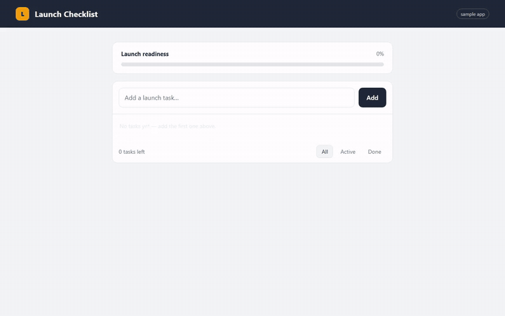

<div align="center">

# 🎬 recording-demo-videos

**Uma skill do Claude Code que transforma "grave uma demo do meu app" em um mp4 roteirizado, legendado — e, se quiser, narrado por IA.**

Sem gravador de tela. Sem microfone. Sem editor de vídeo. Regrave com um comando sempre que o produto mudar.

[](#-instalação)
[](https://playwright.dev)
[-6E56CF)](https://huggingface.co/hexgrad/Kokoro-82M)
[](LICENSE)
[](https://buymeacoffee.com/xh1d3xj)

[🇺🇸 English](README.md) · 🇧🇷 Português

<a href="assets/demo-pt.mp4"></a>

**▶️ [Assista com som (português)](assets/demo-pt.mp4)** · [🇺🇸 versão em inglês](assets/demo-en.mp4)<br>
<sub>Este vídeo foi roteirizado, gravado e narrado pela própria skill — veja <a href="examples/sample-app/record-demo.mjs">examples/sample-app</a>, gravado em um pequeno app fictício incluído neste repositório.</sub>

</div>

---

## ✨ O que você ganha

| | |
|---|---|
| 🎭 **Um pitch, não um screencast** | O Claude escreve um roteiro em 4 atos (visão → como funciona → experiência → prova); cada cena prova um argumento. |
| 🤖 **Interações reais** | O Playwright controla um navegador de verdade: digitação visível, cliques, navegação, troca de persona. |
| 💬 **Legendas na tela** | Barra de legenda com a sua marca, com título + subtexto em cada cena. |
| 🟧 **Atenção guiada** | Um realce âmbar aparece em cada elemento antes do clique. |
| 🎙️ **Narração por IA** *(opcional)* | Inglês com voz natural do [Kokoro](https://huggingface.co/hexgrad/Kokoro-82M) — **offline**, roda em CPU, Apache-2.0. Português do Brasil com vozes neurais da Microsoft (online) ou Kokoro (offline). |
| ⏱️ **Ritmo guiado pelo áudio** | Cada cena dura exatamente o tempo da sua fala — a voz nunca é cortada e as falas nunca se sobrepõem. |
| 🎯 **Sincronia automática** | Um marcador mede o atraso (variável) da gravação do Playwright e alinha cada fala à sua legenda com ~0,1 s de precisão. |
| 📦 **Pronto para compartilhar** | `mp4` (H.264 + AAC — abre no PowerPoint, Slack, WhatsApp), legendas `.srt` e um script regravável (`npm run demo:record`). |
| ✅ **Verificado, não "achado"** | A skill faz o Claude inspecionar frames e conferir o tempo da voz antes de dar o vídeo como pronto. |

## 🚀 Uso

Peça ao Claude Code com suas palavras — *"grave um vídeo de demo do nosso fluxo de checkout"* — ou use o comando:

| Comando | Resultado |
|---|---|
| `/recording-demo-videos` | Vídeo mudo com legendas *(comportamento original)* |
| `/recording-demo-videos audio` | 🇺🇸 Narração em inglês, voz Kokoro offline |
| `/recording-demo-videos audio pt` | 🇧🇷 Narração em português do Brasil (voz edge; cai para o Kokoro offline) |
| `/recording-demo-videos audio pt kokoro` | 🇧🇷 Português 100% offline |

> Instalou como plugin? O comando fica com namespace: `/recording-demo-videos:recording-demo-videos audio pt`.

## 📥 Instalação

### Opção A — Plugin do Claude Code (recomendado)

```text
/plugin marketplace add vribeirocmp/recording-demo-videos
/plugin install recording-demo-videos@vribeirocmp
```

### Opção B — Copiar a skill (comando mais curto)

```bash
git clone https://github.com/vribeirocmp/recording-demo-videos
# macOS / Linux
cp -r recording-demo-videos/skills/recording-demo-videos ~/.claude/skills/
# Windows (PowerShell)
Copy-Item -Recurse recording-demo-videos\skills\recording-demo-videos $HOME\.claude\skills\
```

### Requisitos

| Ferramenta | Para quê | Instalação |
|---|---|---|
| [Node.js](https://nodejs.org) 20.11+ | o script de gravação | — |
| [Playwright](https://playwright.dev) | automação + captura do navegador | `npm i -D playwright && npx playwright install chromium` |
| [ffmpeg](https://ffmpeg.org) | conversão para mp4, mixagem do áudio | `winget install Gyan.FFmpeg` · `brew install ffmpeg` · `apt install ffmpeg` |
| [uv](https://docs.astral.sh/uv/) *(só no modo narrado)* | roda o helper de TTS sem configuração | `pip install uv` ou veja a doc |

A primeira execução narrada baixa o modelo Kokoro uma vez (~120 MB, cache em `~/.cache/recording-demo-videos`). Depois disso, funciona 100% offline.

## 🗣️ Vozes

| Engine | Idioma | Voz padrão | Outras | Observações |
|---|---|---|---|---|
| **Kokoro** | 🇧🇷 Português | `pf_dora` | `pm_alex`, `pm_santa` | Offline, mas bem menos natural que o inglês — use quando não puder ficar online. |
| **Kokoro** *(padrão p/ inglês)* | 🇺🇸 Inglês | `af_heart` | `am_michael`, `bf_emma` 🇬🇧 … | Offline, CPU, Apache-2.0. Inglês excelente. |
| **edge** *(padrão p/ português)* | 🇧🇷 Português | `pt-BR-FranciscaNeural` | `pt-BR-AntonioNeural` … | Melhor qualidade em português, **precisa de internet** (sem internet, cai para o Kokoro). |
| **edge** | 🇺🇸 Inglês | `en-US-AvaMultilingualNeural` | `en-US-AndrewMultilingualNeural` … | Melhor qualidade, **precisa de internet**. |

Escolha a voz com `DEMO_VOICE=pt-BR-AntonioNeural` e o engine com `DEMO_TTS=kokoro|edge` (padrão `auto`: inglês → Kokoro, português → edge). Lista completa do Kokoro: [VOICES.md](https://huggingface.co/hexgrad/Kokoro-82M/blob/main/VOICES.md).

> ⚠️ `edge` usa o [edge-tts](https://github.com/rany2/edge-tts), que conversa com um endpoint **não-oficial** da Microsoft. Ótimo para demos internas e rascunhos; para uso comercial, prefira o Kokoro ou um serviço de TTS oficial.

## ⚙️ Como funciona

1. **`narrate.py`** sintetiza uma fala por cena (Kokoro ou edge) e mede a duração — com cache, só refaz o que mudou.
2. **O Playwright grava** o navegador. Um marcador de sincronia (pré-roll animado → flash magenta) marca o início; cada `narrate(page, "cena")` mostra a legenda, anota o instante e espera a fala terminar.
3. **O ffmpeg** encontra o flash no vídeo (atraso exato da gravação), corta o flash, posiciona cada fala no instante da sua cena e gera `demo.mp4` + `demo.srt` + `timeline.json`.

Por que o marcador? O vídeo do Playwright começa **0,2–1,5 s depois da página abrir**, e esse atraso muda a cada execução e versão. Um offset fixo erra; medir um evento visual conhecido na gravação, não.

## 🧪 Rode o exemplo

```bash
git clone https://github.com/vribeirocmp/recording-demo-videos && cd recording-demo-videos
npm install && npx playwright install chromium
DEMO_LANG=pt node examples/sample-app/record-demo.mjs   # português → examples/sample-app/out/demo.mp4
npm run example                                        # inglês
```

## 🩺 Problemas comuns

| Sintoma | Solução |
|---|---|
| `Sync marker not found` no log | Mantenha `syncMarker(page)` como a primeira ação e regrave. |
| Telas brancas no vídeo | Rode a app em modo produção (ou aqueça as rotas em dev) e espere `networkidle`. |
| A voz pronuncia mal uma sigla | Escreva foneticamente no `say` (`"S Q L"`); a legenda mantém o texto real. |
| `uv` não encontrado | Instale (`pip install uv`) — só é necessário no modo narrado. |

## 🍺 Apoie

Se esta skill te poupou uma tarde gravando tela, considere me pagar uma cerveja:

<a href="https://buymeacoffee.com/xh1d3xj"></a>

## 📄 Licença

[MIT](LICENSE) © Vinicius Ribeiro
